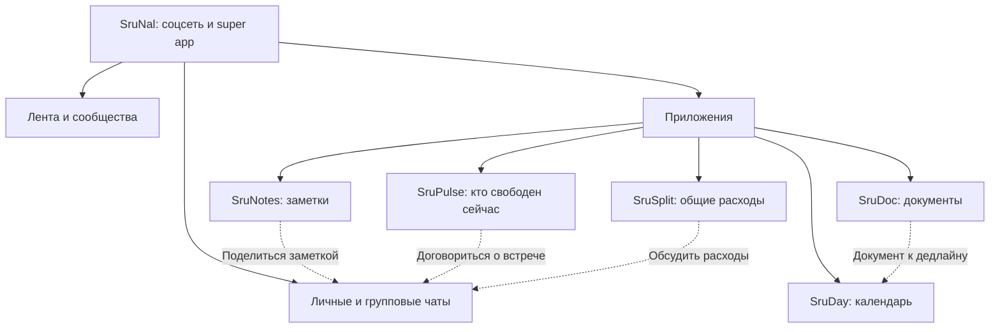

# Каким будет SruNal

## Идея

SruNal является собственной соцсетью с лентой и чатами внутри Telegram Mini App. Пользователь открывает SruNal, чтобы общаться, читать и публиковать посты, а также пользоваться отдельными приложениями из общего каталога.

В SruNal встроен раздел «Приложения»: SruDoc, SruDay, SruPulse, SruNotes и SruSplit. Каждое открывается в своём пространстве с собственной навигацией. Приложения помогают друг другу через понятные действия: заметкой можно поделиться в чате, встречу добавить в календарь, а общие расходы привязать к обсуждению.

## Что подтверждено

| Требование | Решение в концепции |
| --- | --- |
| Название SruNal | Имя самой соцсети и всего super app |
| Telegram Mini App | Основной клиент внутри Telegram |
| Несколько отдельных приложений | Каталог и отдельное пространство каждого приложения |
| Подключить `srunal_docgen` и `sruday` | Используем существующие продукты и постепенно добавляем связи |
| Имя приложения документов SruDoc | Существующий проект DocGen отображается в каталоге как SruDoc |
| Собственная соцсеть с чатом и лентой | Основные разделы SruNal |
| Оставить SruPulse, SruNotes и SruSplit | Три выбранных дополнительных приложения |
| Простые заметки с возможностью делиться | SruNotes с приватностью по умолчанию и явным выбором получателей |
| Уведомления в чате Telegram-бота | Серверная доставка независимо от открытого Mini App |
| Стиль и UX/UI прежнего SruNal DocGen | Общие токены, компоненты и поведение берём из его фронтенда |

## Кто и зачем открывает приложение

Для начала ориентируемся на студентов и небольшие компании друзей. Это рабочая гипотеза по назначению текущих проектов, её нужно проверить на первых пользователях.

| Ситуация | Путь пользователя |
| --- | --- |
| Нужно подготовить документ | SruNal → SruDoc → существующий сценарий заказа |
| Нужно посмотреть расписание | SruNal → SruDay → день или неделя |
| Хочу пообщаться или опубликовать пост | SruNal → чат или лента |
| Хочу найти компанию прямо сейчас | SruNal → SruPulse → статус свободного времени → чат |
| Нужно поделиться заметкой | SruNotes → выбрать заметку и получателей → чат или пост SruNal |
| Нужно разделить общие расходы | SruSplit → группа расходов → сумма и плательщик → расчёт долей |
| Нужно договориться о встрече | Чат SruNal → обсудить → выбрать время через SruDay |
| Нужно связать готовую работу с датой сдачи | SruDoc → выбрать документ → создать или выбрать дедлайн в SruDay |

## Главный экран

Основной стартовый экран SruNal является лентой. В нём находятся:

1. Публикации авторов, на которых подписан пользователь, и доступных ему сообществ.
2. Действие «Написать пост» с выбором аудитории.
3. Комментарии и реакции к публикациям.
4. Переходы в сообщества и уведомления об активности.
5. Основная навигация: «Лента», «Чаты», «Приложения», «Профиль».

## Каталог приложений

В разделе «Приложения» находятся закреплённые сервисы, недавние открытия и полный каталог: SruDoc, SruDay, SruPulse, SruNotes и SruSplit. Каталог доступен прямо из основной навигации.

На карточке приложения достаточно иконки, названия, одного предложения и кнопки открытия. Приложение, которое ещё не готово, обозначается как запланированное и не открывает пустой экран.

При пяти приложениях достаточно простого списка без поиска и сложных категорий. Сводки из приложений появляются только после подключения соответствующего доступа. Например, карточка SruDay может показывать следующую пару, а SruDoc статус последнего заказа.

## Навигация

Основная навигация SruNal: **Лента**, **Чаты**, **Приложения**, **Профиль**. Сообщества доступны из ленты, управление связями приложений из настроек профиля.

Лента и чаты являются частью самой SruNal и доступны без запуска другого приложения. Дневной и недельный календарь находятся внутри SruDay, заметки внутри SruNotes, расходы внутри SruSplit. У приложений сохраняются собственные основные сценарии.

В приложениях, которые уже встроены в оболочку, есть доступный выход «В приложения SruNal». Кнопка Telegram «Назад» возвращает на предыдущий экран текущего приложения. Поведение при выходе из корневого экрана должно быть единым и проверенным на мобильных клиентах.

Существующие Mini Apps сначала могут открываться по Telegram-ссылкам. Такой переход может открывать другое окно Mini App, поэтому вложенную навигацию и автоматический возврат нельзя обещать до проверки. Этот временный режим явно описан в [плане интеграции](03-integrations.md).

## Общий профиль и профиль внутри приложения

В SruNal одна учётная запись с профилем, настройками языка, оформления, закреплённых приложений и разрешённых связей. Telegram используется для подтверждения личности. Публичные поля профиля и участие в общении пользователь настраивает отдельно от доступа к своим приложениям.

Данные приложений принадлежат самим приложениям:

- В SruDoc находятся титульные данные, заказы, оплаты и результаты.
- В SruDay находятся расписание, настройки доступности, друзья и календарные группы.
- В самой SruNal находятся публичное имя, описание, подписки, публикации и переписка.
- В SruPulse находятся статусы свободного времени, их аудитория и отклики.
- В SruNotes находятся заметки и разрешения на их просмотр.
- В SruSplit находятся группы расходов, участники, расходы и расчёты долей.

ФИО из титульного листа, история заказов, заметки, календарь и суммы расходов не становятся публичным содержимым профиля автоматически. Пользователь может пользоваться приложениями, не публикуя посты и не раскрывая эти данные.

На первом этапе смена языка в SruNal меняет оболочку. Синхронизация настроек в приложениях появляется после поддержки соответствующих API; текущее состояние показывается пользователю.

## Принципы интерфейса

Социальные экраны, каталог и приложения используют стиль существующего SruNal DocGen: его тему, типографику, карточки, формы и панели выбора. Новые элементы ленты и чатов строятся на той же основе. Подробный источник компонентов описан в [UI/UX](09-ui-foundation.md).

Поддерживаем светлую и тёмную тему Telegram, безопасные отступы экрана, читаемые подписи, крупные области нажатия и работу с экранной клавиатурой. Для оболочки планируем русский, казахский и английский; фактическую локализацию каждого приложения проверяем отдельно.

Внешние уведомления приходят в личный чат бота SruNal с кнопкой нужного экрана. Сообщения бота по умолчанию не раскрывают текст переписки, заметки и суммы расходов. Доставкой занимается сервер, поэтому закрытие Mini App не отключает уведомления.

Сбой одного сервиса отражается на его карточке и действиях. Остальные разделы по возможности остаются доступны. Недоступность календаря не должна блокировать чат, а сбой чата не должен мешать открыть приложение, чей API работает. Незавершённая форма сохраняется там, где пользователь её заполнял.

## Чем измерять пользу

Смотрим на возвращение в ленту и диалоги SruNal, открытия приложений из каталога, использование нескольких приложений и успешное завершение действий между ними. Для интеграций считаем ошибки и дубли, для заметок успешные открытия у выбранного получателя, для расходов корректность расчёта.

Числовые цели устанавливаем после пилота. Пока спрос и частота использования являются гипотезами.
