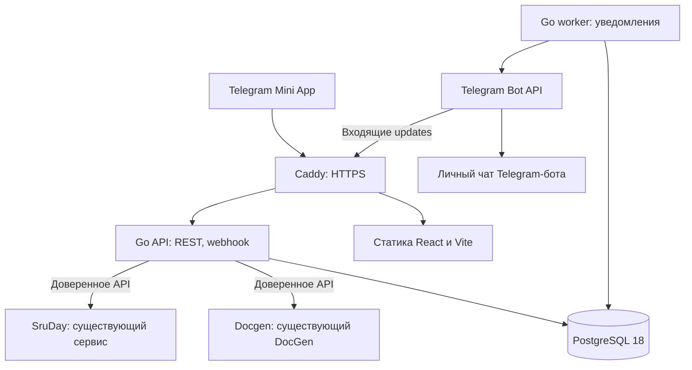

# Архитектура SruNal

Статус: архитектурные границы текущего кода и требования к эксплуатации. Реализованный объём и актуальные ограничения: [README](README.md).

## Основное решение

SruNal является социальной платформой и super app. Новый код строим как **один React SPA и модульное Go-приложение с PostgreSQL 18**. Из одного Go-модуля собираем API, фоновый обработчик и команду миграций. Социальная основа, SruPulse, SruNotes и SruSplit имеют собственные модули, но не требуют отдельных серверов.

**Docgen** является названием приложения в SruNal. За ним стоит существующий проект **DocGen** в `srunal_docgen`. Его генерацию, заказы и базу сохраняем. SruDay также сначала остаётся самостоятельным сервисом. Взаимодействуем с ними через API и адаптеры, без прямого чтения чужих таблиц.

Уведомления пользователю отправляет **Telegram-бот в личный чат**. Доставка не зависит от открытого Mini App. Подробности находятся в [архитектуре уведомлений](08-bot-notifications.md).

Приватное содержимое и Telegram-привязки защищаются серверным AES-256-GCM с ключами вне БД. Сессионные секреты хранятся хэшами; поиск Telegram-аккаунта выполняется по отдельному HMAC-индексу. Границы и обязательные проверки описаны в [модели безопасности](10-security.md).

## Стек

| Часть | Решение | Назначение |
| --- | --- | --- |
| Клиент | React 19, Vite, TypeScript в strict-режиме | Один SPA с отдельными пространствами приложений |
| Навигация | React Router | Лента, календарь `/calendar`, профиль и маршруты четырёх приложений каталога |
| UI | Tailwind CSS 4 и компоненты существующего DocGen | Сохранение выбранного пользователем UI/UX |
| Данные клиента | TanStack Query и обычный `fetch` | Кэш в памяти, пагинация, обновление запросов после изменений |
| Локальное состояние | React state и Context | Формы, выбранный раздел, тема и текущая сессия |
| API | Go, стандартный `net/http` и `log/slog` | REST, вход через Telegram и webhook бота |
| База | PostgreSQL 18, драйвер `pgx/v5` | Основные данные, сессии и очередь уведомлений |
| Миграции | Версионированный SQL, команда `cmd/migrate` | Управляемое изменение схемы до запуска новой версии |
| Обновления открытого клиента | REST и обновление кэша TanStack Query | Лента, календарь и счётчики |
| Уведомления | Telegram Bot API, отправка из worker | Сообщения в личном чате бота |
| Развёртывание | Docker Compose и Caddy | HTTPS, статический фронтенд, API и worker |

React Router, Tailwind, Go, pgx и SQL-миграции уже представлены в существующих проектах. TanStack Query добавляем для общего серверного состояния ленты, календаря и приложений; простые UI-состояния остаются в React. Он предназначен для [получения, кэширования и синхронизации серверных данных](https://tanstack.com/query/latest/docs/framework/react/overview).

Точные версии npm-пакетов и Go зафиксированы в lock-файле и `go.mod`. Для новой базы выбрана ветка PostgreSQL 18 с актуальным исправляющим релизом на момент развёртывания. Она находится в [поддерживаемом списке PostgreSQL](https://www.postgresql.org/support/versioning/). Базы существующих сервисов на PostgreSQL 17 не обновляем этой задачей.

## Процессы и связи



`api` отвечает за запросы пользователя, сохраняет изменения и задания уведомлений. `worker` забирает задания из БД и обращается к Bot API. `migrate` применяется отдельной командой перед запуском совместимых версий API и worker. Долгие внешние вызовы не выполняются внутри транзакций БД.

Для первого запуска достаточно одного экземпляра API и одного worker. Отдельные процессы позволяют перезапустить отправку уведомлений независимо от HTTP. Собственная генерация документов продолжает работать в существующем DocGen.

## Структура репозитория

Код группируем **по приложениям**, чтобы экран, запросы, правила и тесты одной функции находились рядом. На фронтенде и бэкенде используются одинаковые идентификаторы: `doc`, `day`, `pulse`, `notes`, `split`. Социальная основа SruNal находится отдельно в `core`, общий UI и инфраструктура вынесены из приложений.

```text
web/
  src/
    app/                 маршруты, провайдеры, сессия, тема
    core/
      social/            лента и сообщества SruNal
      profile/           профиль и настройки пользователя
    apps/
      doc/               пространство Docgen
      day/               календарь основной вкладки `/calendar`
      pulse/             SruPulse
      notes/             SruNotes
      split/             SruSplit
    shared/
      ui/                компоненты из DocGen
      api/               fetch, ошибки, типы ответа
      telegram/          SDK, кнопки, safe area, ссылки
      i18n/              общий механизм локализации
    styles/              токены и общие стили DocGen
backend/
  go.mod
  cmd/{api,worker,migrate}/main.go
  internal/
    app/                 сборка сервисов и регистрация маршрутов
    core/
      auth/              Telegram-вход и сессии
      user/              аккаунт и настройки
      social/            посты, сообщества, подписки, модерация
      notify/            outbox, доставка, настройки уведомлений
    apps/
      doc/               адаптер API существующего DocGen
      day/               адаптер API существующего SruDay
      pulse/             статусы и отклики
      notes/             заметки и разрешения
      split/             расходы и расчёт долей
    integration/         подтверждённые действия между модулями
    platform/
      httpapi/           HTTP-ошибки и общие middleware
      postgres/          соединения и транзакции
      secure/            шифрование полей, ключи и хэши
      telegram/          клиент Bot API
      config/            конфигурация окружения
db/migrations/           SQL по этапам реализации
deploy/                  Dockerfile, Compose, Caddy
docs/                    продукт и архитектура
```

Это целевая структура, а не команда создать все файлы заранее. В Go используем ручное связывание через конструкторы. HTTP-обработчик вызывает сервис модуля, сервис выполняет правила и обращается к его SQL-коду. Интерфейсы добавляются на нужных границах, например для Bot API и внешних сервисов. Общие пакеты не содержат бизнес-правила приложений.

Например, все Go-файлы заметок находятся в `backend/internal/apps/notes`: HTTP, сервис, SQL, типы и тесты. React-экраны, локальные компоненты и запросы заметок находятся в `web/src/apps/notes`. Приложение не импортирует внутренние файлы другого приложения и не обращается к его таблицам. Связи собирает `integration`, используя публичные методы владельцев данных.

Пофайловый пример, карта приложений и правила добавления кода находятся в [структуре модулей](11-project-layout.md). Этот документ уточняет приведённое дерево и является ориентиром при реализации.

Фронтенд имеет один роутер, одну инициализацию Telegram SDK и одну тему. Приложения загружаются по маршруту через lazy import. Механизмы повторного входа и React-провайдеры старого DocGen целиком в общий клиент не копируются.

## API и вход

Все клиентские запросы идут на тот же origin в `/api/v1`. Caddy отдельно маршрутизирует API и статику; неизвестный API-маршрут возвращает JSON-ошибку, а не `index.html`.

| Маршрут | Ответственность |
| --- | --- |
| `POST /api/v1/auth/telegram` | Проверить `initData`, создать аккаунт или найти существующий, выдать сессию |
| `/api/v1/me` | Профиль и настройки текущего пользователя |
| `/api/v1/feed`, `/api/v1/posts`, `/api/v1/communities` | Социальные данные с проверкой аудитории |
| `/api/v1/notes`, `/api/v1/split`, `/api/v1/pulse` | API соответствующих приложений |
| `/api/v1/apps`, `/api/v1/integrations` | Каталог, привязки и подтверждённые действия между приложениями |
| `POST /bot/webhook` | Входящие Telegram updates с отдельной проверкой секрета webhook |

Проверяем подпись, разрешённого бота и свежесть `auth_date`, затем выдаём случайный непрозрачный токен. В базе хранится только его SHA-256, владелец и срок действия. Клиент передаёт токен в `Authorization: Bearer ...` и держит его в памяти. Перезагрузка вызывает новый проверенный Telegram-вход; dev-обходы запрещены в production. Правила проверки основаны на [документации Telegram](https://core.telegram.org/bots/webapps#validating-data-received-via-the-mini-app).

Сессии отзывные. Просроченная сессия требует нового входа, а устаревший Telegram payload повторного открытия Mini App. Секреты и токены не попадают в URL, `localStorage` или логи. Выход очищает клиентский кэш. Внутреннего потока переписки нет.

Для каждого объекта сервер проверяет владельца, участие или выданный доступ. Ограничение должно присутствовать в SQL-запросе, а не только на экране. Клиентские TypeScript-типы не заменяют серверную проверку тела запроса, размеров и допустимых значений.

Для повторяемых операций используем клиентский UUID: добавление расхода возвращают сохранённый результат при повторе того же запроса. Тот же ключ с другим содержимым даёт конфликт. Конкурентные изменения заметки и расхода используют `version` и ответ `409`, сохраняя возможность восстановить пользовательский ввод.

## Социальные экраны и обновления

Внутренние сообщения, модуль `core/chat` и его API удалены. Личная связь открывается из профиля во внешнем Telegram. Публикации и комментарии читаются через REST с проверкой аудитории; отдельный SSE-поток переписки не создаётся.

Просмотры учитывают уникальные аккаунты после устойчивой видимости карточки, без собственных просмотров автора. Повторные сигналы не накручивают счётчик. Подробные пороги, доступы и профиль: [социальные сценарии](feed-profiles.md).

Календарь SruDay находится в `/calendar`; каталог содержит Docgen, SruPulse, SruNotes и SruSplit. Его адаптер и импорт описаны в [документации SruDay](sruday-integration.md). Очередь Telegram-уведомлений остаётся постоянной в БД и не зависит от открытого WebView.

## Развёртывание и эксплуатация

Фронтенд собирается Vite в статику; dev server и `vite preview` не используются как production-сервер. Это соответствует [модели статического развёртывания Vite](https://vite.dev/guide/static-deploy.html). Caddy завершает TLS, отдаёт сборку и проксирует API. Конфигурация и секреты передаются окружением.

Для разработки PostgreSQL запускается в Docker. Для production предпочтителен managed PostgreSQL; при выборе провайдера первым рассматриваем PlanetScale с проверкой поддержки PostgreSQL 18, региона, резервного копирования и бюджета. Конкретный провайдер не создаётся этой задачей. Самостоятельное размещение возможно по существующей модели VDS, но потребует собственных бэкапов и проверки восстановления.

База не публикуется в интернет без необходимости, доступ ограничивается сетью и ролями. Файлы существующих приложений остаются у владельцев. Для будущих новых вложений используем приватное S3-совместимое хранилище, а в БД только метаданные и разрешения. SruNotes с обычным текстом отдельного файлового хранилища не требует.

Минимальные проверки здоровья: жив ли процесс и доступна ли БД. Логи содержат request ID, тип операции, время и обезличенную ошибку, без текста переписки, заметок, `initData`, токенов и URL Bot API с секретом. Отслеживаем ошибки API, пул соединений, возраст очереди и ошибки доставки уведомлений.

Перед выпуском реализации нужны Go-тесты, интеграционные проверки PostgreSQL для прав и транзакций, TypeScript-проверка и production-сборка. Ключевые сценарии проверяются в Telegram Android, iOS и Desktop. Нагрузочные пределы не объявляем до измерений.

## Границы первой версии

Отдельные приложения остаются отдельными по UX и данным, без микросервиса на каждую карточку. Redis, Kafka, Elasticsearch, Kubernetes и микрофронтенды пока не нужны. Их добавление должно решать измеренную проблему. Новые базы Docgen и SruDay не создаём, исторические данные автоматически не переносим.
